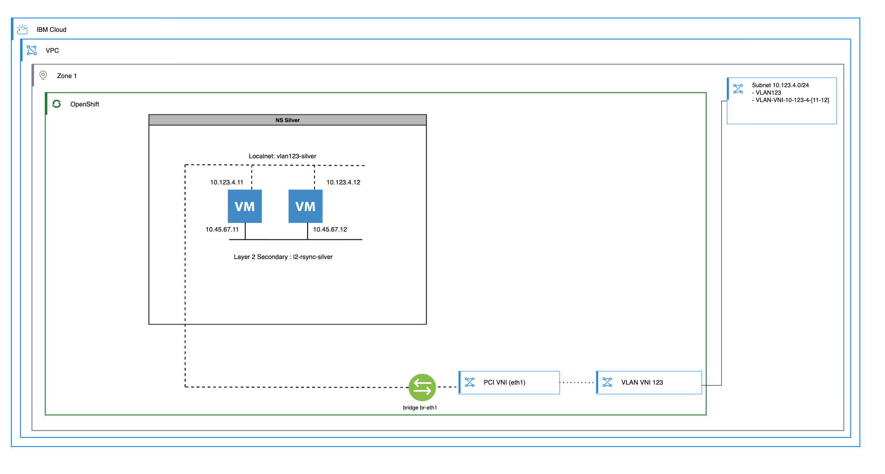

---

copyright:
  years: 2026
lastupdated: "2026-10-27"
lasttested: "[{LAST_TESTED_DATE}]"

keywords: layer 2 secondary, user defined network, OVN-Kubernetes, KubeVirt, rsync, isolated network, ROKS, ROVS, Red Hat OpenShift Virtualization, ibmcloud cli

subcollection: virtualization-solutions

content-type: tutorial
services: openshift
account-plan: paid
completion-time: 45m

---

{{site.data.keyword.attribute-definition-list}}

# {{site.data.keyword.redhat_openshift_notm}} Virtualization: Layer 2 secondary UDN
{: #layer-2-secondary-udn-examples-for-red-hat-openshift-virtualization}
{: toc-content-type="tutorial"}
{: toc-services="openshift"}
{: toc-completion-time="45m"}

Use a _Layer 2 Secondary User-Defined Network (UDN)_ to create an isolated, private overlay between two Fedora&reg; virtual machines that run in {{site.data.keyword.redhat_openshift_notm}} Virtualization on {{site.data.keyword.cloud_notm}}. All {{site.data.keyword.cloud_notm}} Virtual Private Cloud (VPC) resources are created with the `ibmcloud` CLI, and Ansible&reg; is not required.
{: shortdesc}

## Overview
{: #layer2-secondary-overview}

### What is a Layer 2 secondary network?
{: #layer2-secondary-what-is}

A Layer 2 Secondary UDN is an isolated Geneve overlay network that is managed by OVN-Kubernetes. It has no connection to the cluster's default pod network or to the outside world. You can add virtual machines (VMs) and pods in the same namespace to it as extra network interfaces. Key properties:

- The network spans worker nodes and availability zones transparently.
- The network natively supports broadcast and multicast traffic.
- OVN-Kubernetes (OVN-K) can manage IP Address Management (IPAM), or you can disable IPAM so that the VM controls its own addressing.
- The network cannot be promoted to a primary network.

`NetworkPolicy` applies only to the primary network. To filter traffic on a secondary network, you need `MultiNetworkPolicy`. A {{site.data.keyword.redhat_openshift_notm}} Virtualization on {{site.data.keyword.cloud_notm}} (ROVS) cluster does not serve `MultiNetworkPolicy` by default; you must enable it explicitly (see [Step 8: Apply a MultiNetworkPolicy and retest](#layer2-secondary-step-policy)). Without a policy, isolation comes from the network design: the overlay has no gateway and no route to any other network. It does not function as a firewall.
{: note}

### What you build
{: #layer2-secondary-what-you-build}

Two Fedora VMs (`silver-app01` as the source and `silver-app02` as the destination) each has two network interfaces:

| Interface | Network | Type | Subnet | Purpose |
|---|---|---|---|---|
| `enp1s0` | `vlan123-silver` | Localnet (virtual LAN (VLAN) 123) | `10.123.4.0/24` | VPC-routable: management, web |
| `enp2s0` | `l2-rsync-silver` | Layer 2 Secondary | `10.45.67.0/24` | Isolated overlay: only rsync |
{: caption="Interface and network layout for silver virtual machines" caption-side="bottom"}

### Network diagram
{: #layer2-secondary-network-diagram}

The following diagram shows the network topology for `silver-app01` and `silver-app02`. The virtual machines run on separate worker nodes to demonstrate cross-node connectivity over both the Localnet and Layer 2 Secondary networks.

{: caption="Dual-interface setup: Localnet (VPC-routable) and Layer 2 Secondary (isolated overlay) on each virtual machine" caption-side="bottom"}

### Network, namespace, and virtual server details
{: #layer2-secondary-network-details}

The following table lists the network, namespace, and virtual machine values that this tutorial uses.

| Detail | Value |
|---|---|
| Namespace | `silver` |
| Localnet network name | `vlan123-silver` |
| Localnet VLAN | `123` |
| Localnet subnet | `10.123.4.0/24` |
| Localnet gateway | `10.123.4.1` |
| Layer 2 Secondary network name | `l2-rsync-silver` |
| Layer 2 Secondary subnet | `10.45.67.0/24` |
| `silver-app01` enp1s0 address | `10.123.4.11/24` |
| `silver-app01` enp2s0 address | `10.45.67.11/24` |
| `silver-app02` enp1s0 address | `10.123.4.12/24` |
| `silver-app02` enp2s0 address | `10.45.67.12/24` |
| OS | Fedora (from `openshift-virtualization-os-images`) |
| VM size | Small: 1 vCPU, 2 Gi RAM, 30 Gi disk |
{: caption="Example network, namespace, and virtual machine configuration values" caption-side="bottom"}

## Before you begin
{: #layer2-secondary-prereqs}

- A {{site.data.keyword.redhat_openshift_notm}} cluster on {{site.data.keyword.cloud_notm}} with bare-metal worker nodes and Red Hat OpenShift Virtualization installed. This cluster can be a {{site.data.keyword.redhat_openshift_full}} Kubernetes Service (ROKS) cluster with the add-on, or a ROVS cluster.
- The Open vSwitch (OVS) bridge `br-eth1` and the Open Virtual Network (OVN) bridge-mapping `vpc-vlans` that are configured on all worker nodes. Check that both `NodeNetworkConfigurationPolicy` objects are `Available`. Read the names from your own cluster; they can differ:

   ```sh
   oc get nncp
   ```
   {: codeblock}

- The `virtctl` command that is installed. You use it to open each VM's serial console.
- The `ibmcloud` CLI that is installed and logged in:

   ```sh
   ibmcloud login --sso
   ibmcloud target -r ${REGION} -g ${RESOURCE_GROUP}
   ```
   {: codeblock}

- The `ks` plug-in for VNI attachment:

   ```sh
   ibmcloud plugin install kubernetes-service
   ```
   {: codeblock}

- `kubectl` / `oc` that is logged in to the target ROKS cluster.

Set these shell variables, which every step reuses:

```sh
export IC_API_KEY=<your-ibmcloud-api-key>
export REGION=<region>                  # for example eu-de
export ZONE=<zone>                      # a zone where the cluster has workers, for example eu-de-3
export RESOURCE_GROUP=<resource-group>  # the group that holds the cluster VPC
export VPC_NAME=<vpc-name>
export CLUSTER_NAME=<cluster-name>
```
{: codeblock}

The `ibmcloud ks vni` commands accept only the cluster ID, not the cluster name. Retrieve it once:

```sh
CLUSTER_ID=$(ibmcloud ks cluster get --cluster ${CLUSTER_NAME} --output json | jq -r '.id')
echo "Cluster ID: ${CLUSTER_ID}"
```
{: codeblock}

## Create the VPC networking prerequisites
{: #layer2-secondary-step-vpc}
{: step}

### 1.1: Retrieve the VPC ID
{: #layer2-secondary-retrieve-vpc-id}

```sh
VPC_ID=$(ibmcloud is vpc ${VPC_NAME} --output json | jq -r '.id')
echo "VPC ID: ${VPC_ID}"
```
{: codeblock}

Retrieve the default security group ID (which is attached to VNIs so that VPC-internal traffic is permitted):

```sh
SG_ID=$(ibmcloud is vpc ${VPC_NAME} --output json | jq -r '.default_security_group.id')
echo "Security group ID: ${SG_ID}"
```
{: codeblock}

### 1.2: Create the VPC address prefix
{: #layer2-secondary-create-vpc-address-prefix}

```sh
ibmcloud is vpc-address-prefix-create \
  ${ZONE}-vm-rsync \
  ${VPC_ID} \
  ${ZONE} \
  10.123.4.0/24
```
{: codeblock}

Verify:

```sh
ibmcloud is vpc-address-prefixes ${VPC_ID}
```
{: codeblock}

### 1.3: Create the VPC subnet
{: #layer2-secondary-create-vpc-subnet}

The VMs install `httpd` and `rsync` from the internet when they first start, so the subnet requires a public gateway. Find the public gateway that serves your zone in this VPC. If a public gateway does not exist, create one with `ibmcloud is public-gateway-create`:

```sh
PGW_ID=$(ibmcloud is public-gateways --output json \
  | jq -r --arg z "${ZONE}" --arg v "${VPC_ID}" '.[] | select(.zone.name==$z and .vpc.id==$v) | .id' | head -1)
echo "Public gateway ID: ${PGW_ID}"
```
{: codeblock}

```sh
SUBNET_ID=$(ibmcloud is subnet-create \
  ${ZONE}-vm-rsync \
  ${VPC_ID} \
  --zone ${ZONE} \
  --ipv4-cidr-block 10.123.4.0/24 \
  --pgw ${PGW_ID} \
  --resource-group-name ${RESOURCE_GROUP} \
  --output json | jq -r '.id')
echo "Subnet ID: ${SUBNET_ID}"
```
{: codeblock}

### 1.4: Create VNIs with reserved IPs
{: #layer2-secondary-create-vnis}

`ibmcloud is virtual-network-interface-create` creates the VNI and its reserved IP in a single call when you use `--rip-address`, `--rip-name`, and `--rip-auto-delete`. No separate reserved IP creation step or Representational State Transfer (REST) application programming interface (API) call is needed.

Create the VNI for `silver-app01` (reserved IP `10.123.4.11`):

```sh
VNI01_ID=$(ibmcloud is virtual-network-interface-create \
  --name rip-silver-01-${ZONE}-vm-silver-123 \
  --subnet ${SUBNET_ID} \
  --rip-address 10.123.4.11 \
  --rip-name rip-silver-01 \
  --rip-auto-delete false \
  --sgs ${SG_ID} \
  --enable-infrastructure-nat true \
  --auto-delete false \
  --resource-group-name ${RESOURCE_GROUP} \
  --output json | jq -r '.id')
echo "VNI 01 ID: ${VNI01_ID}"
```
{: codeblock}

Create the VNI for `silver-app02` (reserved IP `10.123.4.12`):

```sh
VNI02_ID=$(ibmcloud is virtual-network-interface-create \
  --name rip-silver-02-${ZONE}-vm-silver-123 \
  --subnet ${SUBNET_ID} \
  --rip-address 10.123.4.12 \
  --rip-name rip-silver-02 \
  --rip-auto-delete false \
  --sgs ${SG_ID} \
  --enable-infrastructure-nat true \
  --auto-delete false \
  --resource-group-name ${RESOURCE_GROUP} \
  --output json | jq -r '.id')
echo "VNI 02 ID: ${VNI02_ID}"
```
{: codeblock}

Verify both VNIs and their bound reserved IPs:

```sh
ibmcloud is virtual-network-interfaces --output json \
  | jq '.[] | select(.name | startswith("rip-silver")) | {name, id, primary_ip: .primary_ip.address}'
```
{: codeblock}

### 1.5: Attach VNIs to the ROKS cluster
{: #layer2-secondary-attach-vnis}

```sh
ibmcloud ks vni attach baremetal \
  --cluster-id ${CLUSTER_ID} \
  --vni ${VNI01_ID} \
  --vlan 123

ibmcloud ks vni attach baremetal \
  --cluster-id ${CLUSTER_ID} \
  --vni ${VNI02_ID} \
  --vlan 123
```
{: codeblock}

If the attachment fails with `The CRN token body claims.Identifier must match the CVT of the VNI (P4050)`, wait 20 seconds and run the same command again.

Verify that both VNIs are attached:

```sh
ibmcloud ks vni ls --cluster-id ${CLUSTER_ID}
```
{: codeblock}

### 1.6: Read the MAC addresses of the VNIs
{: #layer2-secondary-read-mac-addresses}

The VPC passes traffic only for the media access control (MAC) address that belongs to the VNI. Each VM must use that MAC address on its `enp1s0` interface. Read them now and use them in the VM manifests in Step 4:

```sh
vni_mac() {
  ibmcloud ks vni ls --cluster-id ${CLUSTER_ID} --output json \
    | jq -r --arg v "$1" '.data.node.networkAttachments.edges[].node.virtualNetworkInterface | select(.externalID==$v) | .macAddress'
}
MAC01=$(vni_mac ${VNI01_ID})
MAC02=$(vni_mac ${VNI02_ID})
echo "silver-app01 MAC: ${MAC01}"
echo "silver-app02 MAC: ${MAC02}"
```
{: codeblock}

## Create the Red Hat OpenShift namespace and Localnet cluster user-defined network (CUDN)
{: #layer2-secondary-step-ns}
{: step}

Create the `silver` namespace:

```sh
oc create namespace silver
```
{: codeblock}

Create the Localnet `ClusterUserDefinedNetwork` for `enp1s0`. This network maps VLAN 123 on the `vpc-vlans` OVS bridge into the `silver` namespace:

```sh
cat <<'EOF' | oc apply -f -
apiVersion: k8s.ovn.org/v1
kind: ClusterUserDefinedNetwork
metadata:
  name: vlan123-silver
spec:
  namespaceSelector:
    matchExpressions:
    - key: kubernetes.io/metadata.name
      operator: In
      values:
        - silver
  network:
    topology: Localnet
    localnet:
      role: Secondary
      physicalNetworkName: "vpc-vlans"
      ipam:
        mode: Disabled
      vlan:
        mode: Access
        access:
          id: 123
EOF
```
{: codeblock}

## Create the Layer 2 secondary network
{: #layer2-secondary-step-l2}
{: step}

Apply the Layer 2 Secondary `ClusterUserDefinedNetwork`, which creates the Geneve overlay for rsync traffic on `enp2s0`:

```sh
cat <<'EOF' | oc apply -f -
apiVersion: k8s.ovn.org/v1
kind: ClusterUserDefinedNetwork
metadata:
  name: l2-rsync-silver
spec:
  namespaceSelector:
    matchExpressions:
    - key: kubernetes.io/metadata.name
      operator: In
      values:
        - silver
  network:
    topology: Layer2
    layer2:
      role: Secondary
      ipam:
        mode: Disabled
EOF
```
{: codeblock}

Key points:

- `topology: Layer2` means a Geneve overlay that spans worker nodes and zones.
- `role: Secondary` means an extra network interface card (NIC) network that cannot become primary.
- `ipam.mode: Disabled` means that each VM sets `10.45.67.x/24` through `nmcli` when it starts.

Wait for both networks to be ready. Each command returns after its network is created:

```sh
oc wait clusteruserdefinednetwork/vlan123-silver clusteruserdefinednetwork/l2-rsync-silver \
  --for=condition=NetworkCreated --timeout=120s
```
{: codeblock}

## Deploy the virtual machines
{: #layer2-secondary-step-vms}
{: step}

Save each of the following manifests to a file: `vm-01.yml` for `silver-app01` and `vm-02.yml` for `silver-app02`. In each file, replace `<MAC01>` or `<MAC02>` with the MAC address from Step 1.6, and replace `<your-password>` with a password of your choice before you apply it. You use that password to sign in at the VM serial console when you verify networking.

The guest operating system assigns interface names based on the order defined in the `interfaces` list: `enp1s0` for Localnet and `enp2s0` for the Layer 2 Secondary network. The `enp1s0` interface receives its IP configuration dynamically from the VPC Dynamic Host Configuration Protocol (DHCP) service. Because DHCP is disabled on the Layer 2 Secondary network, cloud-init configures a static address on `enp2s0` with `nmcli`. The `affinity` specification places the two VMs on separate worker nodes to verify cross-node overlay communication.

You can omit the MAC address and remove the `macAddress` field from the VM interfaces section, or specify a custom MAC address. VPC MAC learning discovers the MAC address of the VM. However, you must configure a static IP address in the guest operating system because DHCP is unavailable on the Layer 2 Secondary network.
{: note}

### Virtual machine silver-app01 in the silver namespace
{: #layer2-secondary-silver-app01-manifest}

```yaml
apiVersion: kubevirt.io/v1
kind: VirtualMachine
metadata:
  name: silver-app01
  namespace: silver
  annotations:
    description: "rsync source VM: enp1s0=localnet VLAN123, enp2s0=L2 secondary"
  labels:
    app: silver
    role: source
    kubevirt.io/dynamic-credentials-support: 'true'
    vm.kubevirt.io/template: "fedora-server-small"
    vm.kubevirt.io/template.namespace: openshift
    vm.kubevirt.io/template.revision: '1'
    vm.kubevirt.io/template.version: v0.34.0
spec:
  dataVolumeTemplates:
    - apiVersion: cdi.kubevirt.io/v1beta1
      kind: DataVolume
      metadata:
        creationTimestamp: null
        name: silver-app01-disk
      spec:
        sourceRef:
          kind: DataSource
          name: fedora
          namespace: openshift-virtualization-os-images
        storage:
          resources:
            requests:
              storage: 30Gi
  runStrategy: RerunOnFailure
  template:
    metadata:
      annotations:
        vm.kubevirt.io/flavor: small
        vm.kubevirt.io/os: fedora
        vm.kubevirt.io/workload: server
      labels:
        kubevirt.io/domain: silver-app01
        kubevirt.io/size: small
        app: silver
    spec:
      affinity:
        podAntiAffinity:
          requiredDuringSchedulingIgnoredDuringExecution:
            - topologyKey: kubernetes.io/hostname
              labelSelector:
                matchLabels:
                  app: silver
      domain:
        cpu:
          cores: 1
          sockets: 1
          threads: 1
        devices:
          disks:
            - disk:
                bus: virtio
              name: rootdisk
            - disk:
                bus: virtio
              name: cloudinitdisk
          interfaces:
            - model: virtio
              name: localnet
              macAddress: "<MAC01>"
              bridge: {}
            - model: virtio
              name: l2secondary
              bridge: {}
          networkInterfaceMultiqueue: true
          rng: {}
        memory:
          guest: "2Gi"
      hostname: silver-app01
      networks:
        - name: localnet
          multus:
            networkName: vlan123-silver
        - name: l2secondary
          multus:
            networkName: l2-rsync-silver
      terminationGracePeriodSeconds: 180
      volumes:
        - dataVolume:
            name: silver-app01-disk
          name: rootdisk
        - cloudInitNoCloud:
            userData: |-
              #cloud-config
              user: admin
              password: "<your-password>"
              ssh_pwauth: true
              chpasswd: { expire: False }
              runcmd:
                - nmcli con add type ethernet ifname enp2s0 con-name enp2s0
                - nmcli con mod enp2s0 ipv4.method manual ipv4.addresses 10.45.67.11/24
                - nmcli con mod enp2s0 ipv6.method ignore
                - nmcli con up enp2s0
                - dnf install -y httpd rsync
                - systemctl enable --now httpd
                - echo "Hello from silver-app01" > /var/www/html/index.html
          name: cloudinitdisk
```
{: codeblock}

### Virtual machine silver-app02 in the silver namespace
{: #layer2-secondary-silver-app02-manifest}

```yaml
apiVersion: kubevirt.io/v1
kind: VirtualMachine
metadata:
  name: silver-app02
  namespace: silver
  annotations:
    description: "rsync destination VM: enp1s0=localnet VLAN123, enp2s0=L2 secondary"
  labels:
    app: silver
    role: destination
    kubevirt.io/dynamic-credentials-support: 'true'
    vm.kubevirt.io/template: "fedora-server-small"
    vm.kubevirt.io/template.namespace: openshift
    vm.kubevirt.io/template.revision: '1'
    vm.kubevirt.io/template.version: v0.34.0
spec:
  dataVolumeTemplates:
    - apiVersion: cdi.kubevirt.io/v1beta1
      kind: DataVolume
      metadata:
        creationTimestamp: null
        name: silver-app02-disk
      spec:
        sourceRef:
          kind: DataSource
          name: fedora
          namespace: openshift-virtualization-os-images
        storage:
          resources:
            requests:
              storage: 30Gi
  runStrategy: RerunOnFailure
  template:
    metadata:
      annotations:
        vm.kubevirt.io/flavor: small
        vm.kubevirt.io/os: fedora
        vm.kubevirt.io/workload: server
      labels:
        kubevirt.io/domain: silver-app02
        kubevirt.io/size: small
        app: silver
    spec:
      affinity:
        podAntiAffinity:
          requiredDuringSchedulingIgnoredDuringExecution:
            - topologyKey: kubernetes.io/hostname
              labelSelector:
                matchLabels:
                  app: silver
      domain:
        cpu:
          cores: 1
          sockets: 1
          threads: 1
        devices:
          disks:
            - disk:
                bus: virtio
              name: rootdisk
            - disk:
                bus: virtio
              name: cloudinitdisk
          interfaces:
            - model: virtio
              name: localnet
              macAddress: "<MAC02>"
              bridge: {}
            - model: virtio
              name: l2secondary
              bridge: {}
          networkInterfaceMultiqueue: true
          rng: {}
        memory:
          guest: "2Gi"
      hostname: silver-app02
      networks:
        - name: localnet
          multus:
            networkName: vlan123-silver
        - name: l2secondary
          multus:
            networkName: l2-rsync-silver
      terminationGracePeriodSeconds: 180
      volumes:
        - dataVolume:
            name: silver-app02-disk
          name: rootdisk
        - cloudInitNoCloud:
            userData: |-
              #cloud-config
              user: admin
              password: "<your-password>"
              ssh_pwauth: true
              chpasswd: { expire: False }
              runcmd:
                - nmcli con add type ethernet ifname enp2s0 con-name enp2s0
                - nmcli con mod enp2s0 ipv4.method manual ipv4.addresses 10.45.67.12/24
                - nmcli con mod enp2s0 ipv6.method ignore
                - nmcli con up enp2s0
                - dnf install -y httpd rsync
                - systemctl enable --now httpd
                - mkdir -p /var/www/html/synced
                - chown admin:admin /var/www/html/synced
          name: cloudinitdisk
```
{: codeblock}

### Apply and monitor
{: #layer2-secondary-apply-monitor}

```sh
oc apply -f vm-01.yml
oc apply -f vm-02.yml
```
{: codeblock}

Wait until both VMs are running:

```sh
oc wait vm/silver-app01 vm/silver-app02 -n silver --for=condition=Ready --timeout=900s
```
{: codeblock}

`Ready` indicates that the VM started, not that cloud-init finished. Wait about three more minutes for the package installation to complete. Run `sudo cloud-init status --wait` inside the VM serial console to confirm when it is done.
{: note}

Confirm that the VMs are on different worker nodes. The `NODENAME` column must differ:

```sh
oc get vmi -n silver -o wide
```
{: codeblock}

## Verify networking
{: #layer2-secondary-step-verify}
{: step}

The VMs have no address on the cluster pod network, so `virtctl ssh` cannot reach them. Instead, use each VM's serial console. In a terminal, open the console of `silver-app01`:

```sh
virtctl console -n silver silver-app01
```
{: codeblock}

Press Enter, then sign in as `admin` with the password from the manifest. Press Ctrl+] to exit a console.

Wait for cloud-init to finish. It prints `status: done`. A normal user needs `sudo` for this command. The console also shows startup messages for the first minute or so; press Enter again if you do not see a prompt:

```sh
sudo cloud-init status --wait
```
{: codeblock}

Open the console of `silver-app02` in the same way:

```sh
virtctl console -n silver silver-app02
```
{: codeblock}

On `silver-app01`:

```sh
# Both interfaces are up with correct addresses
ip addr show enp1s0   # inet 10.123.4.11/24
ip addr show enp2s0   # inet 10.45.67.11/24

# VPC gateway reachable over enp1s0
ping -c 3 10.123.4.1

# silver-app02 reachable over the isolated Layer2 Secondary
ping -c 3 10.45.67.12
```
{: codeblock}

Confirm that Apache® is running on `silver-app01`:

```sh
curl -s http://10.123.4.11/
# Hello from silver-app01
```
{: codeblock}

## Run rsync over the Layer 2 secondary
{: #layer2-secondary-step-rsync}
{: step}

All replication traffic travels over `enp2s0` (`10.45.67.x`), the Geneve overlay, and remains separate from the VPC-routable `enp1s0` network.

### One-shot sync
{: #layer2-secondary-oneshot-sync}

Rsync runs over Secure Shell (SSH). Give `silver-app01` an SSH key, and send its public half to `silver-app02` over the Layer 2 Secondary. The private key stays on `silver-app01`. On `silver-app01`:

```sh
ssh-keygen -t ed25519 -N "" -f ~/.ssh/id_ed25519
ssh-copy-id -o StrictHostKeyChecking=accept-new admin@10.45.67.12
```
{: codeblock}

Enter the VM password when `ssh-copy-id` asks for it. Then, run rsync from `silver-app01`:

```sh
rsync -avz --progress \
  /var/www/html/ \
  admin@10.45.67.12:/var/www/html/synced/
```
{: codeblock}

Expected output (the byte counts on your system can differ):

```text
sending incremental file list
./
index.html
             24 100%    0.00kB/s    0:00:00 (xfr#1, to-chk=0/2)

sent 154 bytes  received 38 bytes  384.00 bytes/sec
total size is 24  speedup is 0.12
```
{: screen}

### Verify on silver-app02
{: #layer2-secondary-verify-silver-app02}

From `silver-app01`:

```sh
ssh admin@10.45.67.12 cat /var/www/html/synced/index.html
# Hello from silver-app01
```
{: codeblock}

## Test the network setup
{: #layer2-secondary-step-test}
{: step}

Run these tests from the VM consoles. Open two terminals, one for each VM:

```sh
# Terminal 1: silver-app01
virtctl console -n silver silver-app01

# Terminal 2: silver-app02
virtctl console -n silver silver-app02
```
{: codeblock}

### Tests
{: #layer2-secondary-test-scenarios}

Run all of the following tests. Each test returns the result that is described.

1. Confirm that both interfaces are up on each VM

   ```sh
   # On silver-app01
   ip addr show enp1s0   # expect 10.123.4.11/24
   ip addr show enp2s0   # expect 10.45.67.11/24

   # On silver-app02
   ip addr show enp1s0   # expect 10.123.4.12/24
   ip addr show enp2s0   # expect 10.45.67.12/24
   ```
   {: codeblock}

2. Ping across the Layer 2 Secondary (enp2s0)

   ```sh
   # From silver-app01
   ping -c 3 10.45.67.12

   # From silver-app02
   ping -c 3 10.45.67.11
   ```
   {: codeblock}

   Both succeed. A round-trip time of about 1–3 milliseconds, with the VMs on different nodes, confirms that they are on the same Geneve segment.

3. Confirm that Apache is reachable on both VMs over enp1s0 (Localnet)

   ```sh
   # From silver-app02, reach silver-app01 over the Localnet
   curl -sv http://10.123.4.11/
   # Hello from silver-app01

   # From silver-app01, reach silver-app02 over the Localnet
   curl -sv http://10.123.4.12/synced/
   # Hello from silver-app01 (Step 6 copied index.html into this folder)
   ```
   {: codeblock}

4. Confirm that Apache is reachable between VMs over the Layer 2 Secondary (enp2s0)

   ```sh
   # From silver-app01, reach silver-app02 over the isolated overlay
   curl -sv http://10.45.67.12/synced/
   # Hello from silver-app01

   # From silver-app02, reach silver-app01 over the isolated overlay
   curl -sv http://10.45.67.11/
   # Hello from silver-app01
   ```
   {: codeblock}

5. Run rsync over the Layer 2 Secondary

   ```sh
   # From silver-app01
   rsync -avz --progress \
     /var/www/html/ \
     admin@10.45.67.12:/var/www/html/synced/
   ```
   {: codeblock}

   Because the rsync run in Step 6 already copied the file, rsync sends nothing and the output lists no files. Confirm that the file is on `silver-app02`:

   ```sh
   # From silver-app02
   cat /var/www/html/synced/index.html
   # Hello from silver-app01
   ```
   {: codeblock}

6. Confirm that rsync also works over the Localnet (enp1s0)

   ```sh
   # From silver-app01, rsync to the enp1s0 address
   rsync -avz -e "ssh -o StrictHostKeyChecking=accept-new" \
     /var/www/html/ admin@10.123.4.12:/var/www/html/synced/
   ```
   {: codeblock}

   Rsync over the Localnet succeeds, and `ssh` adds the new address to the known hosts. Nothing forces rsync onto the overlay. You choose the path by the address that you type. Use the `10.45.67.x` address to keep the traffic off the VPC network.

## Apply a MultiNetworkPolicy and retest
{: #layer2-secondary-step-policy}
{: step}

A `MultiNetworkPolicy` applies firewall rules to one network attachment. The policy in the following steps targets the `l2-rsync-silver` Layer 2 Secondary.

### 8.1: Turn on MultiNetworkPolicy
{: #layer2-secondary-switch-policy}

Turn on MultiNetworkPolicy in the Cluster Network Operator:

```sh
oc patch network.operator.openshift.io cluster --type=merge \
  -p '{"spec":{"useMultiNetworkPolicy":true}}'
```
{: codeblock}

This setting modifies a configuration that {{site.data.keyword.IBM_notm}} manages and is not officially supported for ROVS clusters. The setting restarts OVN-Kubernetes pods across all worker nodes, which can cause temporary network disruption for active VMs. Apply this change during a scheduled maintenance window or in a development environment.
{: important}

Wait until the new resource exists:

```sh
oc wait --for=condition=Established crd/multi-networkpolicies.k8s.cni.cncf.io --timeout=300s
```
{: codeblock}

The resource is `multi-networkpolicies`, with a hyphen, in the API group `k8s.cni.cncf.io/v1beta1`.

### 8.2: Apply the policy
{: #layer2-secondary-apply-policy}

A policy can allow traffic but cannot explicitly deny it. After a policy selects a VM, all traffic that the policy does not allow is dropped. The following policy allows only SSH (Transmission Control Protocol (TCP) port 22) into the VMs over the Layer 2 Secondary. This policy keeps rsync working and blocks Hypertext Transfer Protocol (HTTP) and pings on that network:

```sh
cat <<'EOF' | oc apply -f -
apiVersion: k8s.cni.cncf.io/v1beta1
kind: MultiNetworkPolicy
metadata:
  name: allow-ssh-only-l2-secondary
  namespace: silver
  annotations:
    k8s.v1.cni.cncf.io/policy-for: silver/l2-rsync-silver
spec:
  podSelector: {}
  policyTypes:
    - Ingress
  ingress:
    - ports:
        - protocol: TCP
          port: 22
EOF
```
{: codeblock}

The `podSelector: {}` parameter selects every VM in the `silver` namespace. The `policy-for` annotation names the network that the policy applies to, so traffic on `vlan123-silver` (`enp1s0`) is not affected.
{: note}

### 8.3: Rerun the tests
{: #layer2-secondary-rerun-tests}

#### Test A: HTTP over the Layer 2 secondary is blocked
{: #layer2-secondary-test-a}

```sh
# From silver-app01
curl -sv --max-time 5 http://10.45.67.12/synced/
```
{: codeblock}

Expected result: The request times out. The policy drops `TCP 80` on `enp2s0`.

#### Test B: rsync over the Layer 2 secondary still works
{: #layer2-secondary-test-b}

```sh
# From silver-app01
rsync -avz --progress \
  /var/www/html/ \
  admin@10.45.67.12:/var/www/html/synced/
```
{: codeblock}

Expected result: rsync completes because it runs over SSH (`TCP 22`).

#### Test C: ping over the Layer 2 secondary is blocked
{: #layer2-secondary-test-c}

```sh
# From silver-app01
ping -c 3 -W 2 10.45.67.12
```
{: codeblock}

Expected result: 100% packet loss. The policy allows only `TCP 22`, so Internet Control Message Protocol (ICMP) is dropped.

#### Test D: HTTP over the Localnet is unaffected
{: #layer2-secondary-test-d}

```sh
# From silver-app02
curl -s http://10.123.4.11/
# Hello from silver-app01
```
{: codeblock}

Expected result: The request succeeds. The policy is scoped to `l2-rsync-silver`.

### 8.4: Remove the policy
{: #layer2-secondary-remove-policy}

```sh
oc delete multi-networkpolicies allow-ssh-only-l2-secondary -n silver
```
{: codeblock}

Rerun Test A and Test C. Without the policy, both requests succeed.

## Clean up
{: #layer2-secondary-step-cleanup}
{: step}

Delete the VMs, the networks, and the namespace. The `useMultiNetworkPolicy` setting from [Step 8.1: Turn on MultiNetworkPolicy](#layer2-secondary-switch-policy) can remain enabled. To restore the cluster to its original state, set it back to `false`.

```sh
oc delete vm silver-app01 silver-app02 -n silver
oc delete clusteruserdefinednetwork vlan123-silver l2-rsync-silver
oc delete namespace silver
```
{: codeblock}

Detach the VNIs from the cluster, then delete them and the VPC resources. When you delete the subnet, its reserved IPs are also removed. The commands keep the public gateway in place, because other subnets might use it:

```sh
ibmcloud ks vni detach --cluster-id ${CLUSTER_ID} --vni ${VNI01_ID} -f
ibmcloud ks vni detach --cluster-id ${CLUSTER_ID} --vni ${VNI02_ID} -f

ibmcloud is virtual-network-interface-delete ${VNI01_ID} ${VNI02_ID} -f
ibmcloud is subnet-delete ${SUBNET_ID} -f
ibmcloud is vpc-address-prefix-delete ${VPC_ID} ${ZONE}-vm-rsync -f
```
{: codeblock}

## Reference
{: #layer2-secondary-reference}

### IP address summary
{: #layer2-secondary-ip-summary}

The following table summarizes the IP addresses that each virtual machine and the gateway use on each network.

| | `enp1s0` (Localnet VLAN 123) | `enp2s0` (Layer 2 Secondary) |
|---|---|---|
| `silver-app01` | `10.123.4.11/24` | `10.45.67.11/24` |
| `silver-app02` | `10.123.4.12/24` | `10.45.67.12/24` |
| Gateway | `10.123.4.1` | Not applicable (isolated, no gateway) |
{: row-headers}
{: caption="Summary of virtual machine network and IP assignments" caption-side="bottom"}
{: summary="This table has row and column headers. The row headers identify each virtual machine and the gateway. The column headers identify the Localnet interface and the Layer 2 secondary interface. To find an address, go to the row for the virtual machine or gateway, and then find the column for the interface."}
{: #layer2-secondary-ip-summary-table}
